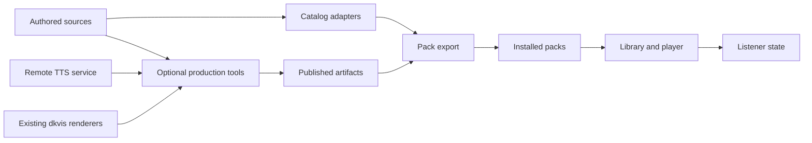

# Audio first library and portable content pack refactor

Planning proposal, 15 November 2026.

Make the library a collection of independently authored lectures, courses, and
portable media. Audio lectures are the primary experience. Manim presentations,
companion slides, music examples, and other media remain supported ways to teach
the same material. Authoring a strong lecture must continue to work without a
slide deck or a rendering toolchain.

The first implementation should make existing content portable and make the
whole collection easy to browse. Introduce a small content and artifact layer,
adapt the current directories to it, then migrate production and UI callers in
small passes. Keep working renderers and existing playback addresses during the
transition. Moving hundreds of manuscripts is a later step.

One local web server handles prepared playback and optional remote TTS. Recording
availability and backend availability are independent facts, not deployment
modes. Packs can be added or revised while the server is running, without editing
a shared authored registry. All content is accessible without login. Optional
listener profiles provide remembered progress across devices; they do not grant
or restrict access.

## Source delivery simplification

Source delivery accepts ordinary pack ZIPs. Snapshot receipts and the earlier
hash-aware envelope are optional tool conveniences, not authoring requirements.
An import protects paths and existing work, stages incoming files and undo copies,
and publishes under the same lock used by catalog reads. Failed or interrupted
imports recover to the previous source version. Plain ZIPs can replace one
explicitly owned directory while retaining a backup.

Delivery does not require complete manifests, citations, recordings, or access
to TTS. The reader discovers unindexed numbered manuscripts outside the declared
course order, isolates bad items, and keeps usable catalog snapshots across
restarts. Editorial diagnostics and optional authoring checks remain separate
from service availability. Routine imports run no tests or media builds.

## Implementation status

The first implementation now lives in `ailectures/`; see the
[operator and pack guide](../content-packs.md). It adds a live catalog adapter,
immutable source/media releases, concurrent transactional activation, standalone
playback packaging, the unified library/player, optional remembered listeners,
revision-bound feedback, and optional generation through the existing TTS clients.
`make serve` opens this library with the original readers loaded lazily for their
compatibility URLs. New sources can use `content/<namespace>/`; existing authored
folders remain supported through adapters. Physical moves of established lecture
folders are not needed for portable exports and have not been performed.

The implementation uses bounded polling and explicit refresh, with SQLite as the
activation authority and a generated diagnostic lock file. It retains old releases
without automatic garbage collection. Existing mathematical renderers and their
scene compositions remain in `dkvis`.

The household browsing UI uses **Collections** and category-first navigation.
Optional pack-local `categories` and `audiences` permit multiple groupings without
changing lecture identities or ordered membership. The existing course records
and URLs remain compatible. Bedtime stories are a direct category destination;
mathematics collections are grouped together. No physical source moves are needed
for this organization, and existing authoring handoffs remain valid.

The final pass separates Production UI into its own native module and adds
optional companion file downloads with attribution and exact file identity.
Missing companions leave narration usable. The final reader wheel was exercised
outside the checkout with three independent packs and 35 actual exported audio
segments, without outbound connections or accessible FFmpeg tools. Independent
process publication and killed-activation recovery are covered. See the
[completion audit](refactor-completion-audit.md) for evidence. Established source
folders stay in place while authors continue; physical migration and synchronized
companion playback remain later work.

The browser closeout adds a native typed learning map with retained component
evidence, inline prepared slide companions, explicit optional repository-deck
build/view controls, and pack ZIP downloads with optional published audio.
Individual-block generation, opt-in continuation/lookahead and whole-lecture
caching already live in the native lecture controls. Chromium decoded, sought
and briefly played all 35 real exported segments in the isolated installation,
kept playback through navigation and resumed a shared listener in a second
browser context. Six configured host speech endpoints were unreachable, so the
conditional live-synthesis check remains unexercised; controlled Kokoro/Breeze
protocol tests passed. Writers can continue without waiting for that service.

## Current repository evidence

Baseline: commit `1ad9dbe`, inspected 15 November 2026. Counts describe this checkout
and can change as independent lecture contributions arrive.

| Area | Current state | Refactor consequence |
| --- | --- | --- |
| Audio corpus | `python tools/lecture_inventory.py` reports 656 manuscripts, 19 tracks, zero inventory problems. | Preserve manifest discovery and validate the complete inventory after each integration. |
| Registration | `AudioLectureHub` discovers `draft-stages/tts-*/track.json`; G2 uses filename order. | Extend a working data-driven system rather than adding another list of courses in Python. |
| Identity | Audio addresses and graph nodes already pair a track with a six-digit lecture ID. Numbers repeat across tracks. | Retain qualified IDs and existing aliases. A six-digit number alone is not a library-wide identity. |
| Audio service | `audio_library.py` combines extraction, discovery, pagination, profile loading, synthesis, artifact lookup, and voice registration in 1,123 lines. | Separate catalog and playback from generation incrementally. |
| Cache identity | `_target_from_text` includes endpoint, local profile, pagination, voice, and synthesis settings. | Copying MP3 files alone does not provide portable discovery under another machine's settings. |
| Server startup | `create_app` builds the mathematical course graph and companion catalog, then creates an audio hub. | A music-only installation needs an independently loadable catalog. |
| UI | `/` is the original presentation library; `/audio` appends tracks to a navigation row and places generation controls inside the player. | Introduce one library home and separate browsing, listening, and production. |
| Local media | `audio-cache/` contains 1,094 MP3 files, about 264 MiB. `renders/` has no rendered media in this checkout. | Existing audio is worth preserving; file count does not establish how many current lectures are completely recorded. |
| Reading references | Some tracks fall back to the G2 `metadata/sources.json`. | Export the referenced source records explicitly so a standalone pack has no hidden G2 dependency. |
| Production state | Voice registrations live under `audio-cache/`; viewer feedback is already separate. Background preparation jobs are in memory. | Distinguish durable settings, listener data, published artifacts, and disposable build work. |
| Music | The music track has 24 lectures and validated, declarative score examples. Its example guide describes seven machine-checkable examples without recordings. | Preserve those sources and add optional realizations later. |

The current TTS infrastructure belongs to the neighboring `local-ai` repository.
Its TTS service supplies OpenAI-compatible speech APIs and an optional Breeze
paragraph/job API. Keep service provisioning, model weights, and voice references
there. This library owns manuscripts, render requests, validated outputs, and
playback. Server connectivity is not a prerequisite for this plan or for offline
playback; live endpoint compatibility needs a later integration check.

Relevant implementation anchors:

- [Audio catalog and generation](../../dkvis/presentation/audio_library.py)
- [Web server](../../dkvis/presentation/serve.py)
- [Audio reader](../../dkvis/presentation/audio_library.html)
- [Presentation catalog](../../dkvis/presentation/library.py)
- [Course graph](../../dkvis/presentation/course_graph.py)
- [Corpus inventory](../../tools/lecture_inventory.py)
- [Concurrent contribution merge](../../tools/merge_world_history_overlay.py)
- [Music example contract](../../content/music-theory/examples/README.md)
- [External asset contract](../EXTERNAL_ASSETS.md)

## Content model

Keep these concepts distinct even when a first pack contains exactly one course.

| Object | Meaning | Identity and revision |
| --- | --- | --- |
| Lecture | An authored teaching unit with narration, notes, reading references, provenance, and optional companions. | Stable qualified ID, such as `music-theory:001000`; separate content revision. |
| Course or series | A named, ordered route through lectures, with sections and teaching context. | Stable qualified course ID; membership and ordering can change without renaming lectures. |
| Content pack | A portable distribution of selected lectures, courses, and supporting records. | Stable pack ID and immutable release digest. Pack membership does not define lecture identity. |
| Narration variant | A particular narrator, model/voice revision, language, delivery settings, and processing recipe. | Stable public variant label plus exact recipe digest. |
| Artifact | Actual audio, video, slides, images, scores, or timing data. | Exact file checksum and the content inputs it realizes. |
| Library configuration | The releases enabled on a particular server and its preferred variants. | Local configuration and a resolved lock file. |
| Listener profile | A name and durable listening state selected by a person. | Server-issued profile ID remembered on devices; independent of content packs. |

One lecture can appear in several courses. A course can reference several packs.
A new voice can be distributed as an audio add-on to an existing source pack.
A collection can be repackaged without creating different lecture identities or
losing listening progress. One pack per existing audio track is the first useful
mapping, not a permanent restriction.

Preserve `g2:000000`, `g3:000000`, and other existing audio identities. Allocate
new namespace names independently of directory ordering; local IDs need only be
unique within their namespace. Existing contribution reservations, including the
World History archaeology range, continue to apply within those namespaces.
Conflicting namespace ownership must be reported during integration.

For G1 presentations, use stable deck IDs in new records and preserve existing
folder-derived graph identifiers as aliases. Keep `lectures/index.yaml` as the
authority for the original presentation syllabus until its adapter can preserve
all its behavior. Physical renumbering must never change a public identity.

Teaching prerequisites, proof dependencies, historical influence, derivation,
and listening order remain different relationships. A missing suggested lecture
must not prevent access to the selected lecture.

## Pack format and transfer

### Three export selections

| Selection | Contents | Intended use |
| --- | --- | --- |
| Source | Manifest, manuscripts, metadata, provenance, reading records, declarative companion sources, and available build recipes. | Independent authoring or rendering on another capable machine. |
| Playable | Runtime catalog, exact spoken transcripts, provenance and attribution, measured media metadata, selected pre-rendered media and their supporting files. | Offline service on a small machine. Editable source can also be included. |
| Media add-on | New recordings or companions bound to exact source inputs, with the required base content declared. | Transfer another narrator or add visuals without recopying unchanged sources. |

Use a versioned JSON manifest and a directory layout first; an archive transports
the same directory. JSON builds on the existing track and metadata formats and
keeps the reader independent of Python manifests. An archive is an export, not
the only way to mount a pack: an unpacked external directory must also work.

A source release also declares the producer/plugin versions and external build
dependencies it needs. A Manim source export may require the corresponding
`dkvis` release on its rendering machine; this must be explicit. Installing a
pack only loads its records and media. Rendering is an explicit production
action, and its toolchain is independent of the playback installation.

Every playable release includes the text actually used for its audio. The reader
must not infer speech text from a newer manuscript. Non-spoken reading notes and
authorship are retained alongside it. External reading links can remain links;
offline playback does not promise offline access to every cited publication.

An illustrative layout, to be finalized as a schema in the first implementation:

```text
music-theory/
  pack.json
  catalog.json
  courses/main.json
  lectures/001000/lecture.md           # source selection
  lectures/001000/spoken.txt
  lectures/001000/metadata.json
  provenance/...
  sources/records.json
  examples/...
  artifacts/narrator-a-v1/001000/
    recording.json
    000.mp3
    001.mp3
    timings.json
  checksums.json
```

The manifest declares schema version, pack ID, namespaces, title, release digest,
included courses and lectures, source/artifact indexes, required pack releases,
and attribution/license records. Paths are relative to the pack. The release
digest covers canonical manifest data excluding its own digest, plus the sorted
payload checksum index. Re-exporting unchanged inputs should produce the same
logical release even if archive container timestamps differ.

A recording record declares qualified lecture ID, spoken-text digest, variant
and recipe identity, ordered segment paths, checksums, sizes, codec, measured
durations, and optional timings. Also record the segment text mapping and
segmentation policy so the reader never has to regenerate pagination to locate
audio. Timing records distinguish measured boundaries, interpolated highlights,
and forced alignment. No new timing claim should be inferred from an MP3 name.

Require a playable export to contain complete selected lectures for the selected
variant. A source export can contain no audio. A deliberately partial media
add-on must enumerate its coverage and appear as partial in the reader. Existing
chunked audio is the first playback representation; a joined lecture file is an
optional later output. Transcoding is a production operation.

### Independent composition and installation

`library.toml` configures pack discovery roots, optional release pins/exclusions,
preferred narration, and optional TTS connections. Every valid pack published
under a configured discovery root can register through its own manifest; adding
a pack does not require adding it to `library.toml`. Explicitly selected external
roots are also supported. `library.lock.json` is a machine-generated record of
the exact active releases and resolved artifacts. The catalog is derived from
pack manifests and local selection policy; it does not become a second authored
lecture inventory. Neither the lock file nor local server configuration belongs
in an agent's content contribution.

Installation stages files, checks schema compatibility, paths, checksums,
required dependencies, and identity conflicts, then activates a complete
catalog snapshot. An interrupted install leaves the previous library usable.
Reject archive traversal, escaping links, and duplicate entries; never extract
an archive directly over the working repository. Check storage needs before
copying large media.

For the first version, activate one release per pack and one content revision
per lecture. Identical lecture records shared by packs can coalesce. Different
revisions of the same lecture require an explicit selection or update; directory
scan order must never choose a winner. Narration add-ons match the spoken digest
and relevant companion inputs rather than invalidating all recordings when an
unrelated lecture in the source pack changes.

Required pack dependencies must be explicitly installed and resolved. Suggested
cross-pack readings and optional companions can be unavailable. Show unavailable
course steps and links clearly; do not silently rewrite a curated course order.
Removing a pack preserves listener history and feedback. Garbage collection can
remove unreferenced media only after resolving all active pack references.

Use filesystem directories and checksum indexes initially. A shared blob store,
remote pack registry, delta downloads, and signing infrastructure can be added
if actual distribution needs justify them.

### Live discovery and concurrent publication

Adding, revising, enabling, or removing a content pack must not require a server
restart. Use filesystem notifications where available, bounded periodic
reconciliation as a fallback, and an explicit Refresh action. Reconciliation
must also detect missed filesystem events and atomically replaced manifests.
The configured polling interval defines the discovery delay; content changes
must not depend on re-importing Python modules. This guarantee covers content
and supported declarative companions. Changing server or renderer code can still
require a process restart.

Publish each release to a unique staging directory, validate it, then make it
discoverable with an atomic rename or completion marker. Incomplete directories
and invalid candidates never replace the active release. Published releases are
immutable: a modification produces a new release rather than rewriting files
that an active player may still be fetching. An optional development watcher
can snapshot mutable source directories into this same release workflow after
validation; it must not expose a half-written manuscript/manifest pair.

Independent producers write only their own pack files. Source records, course
order, relationships, aliases, and artifact indexes are pack-local and use
qualified IDs. Cross-pack relationships are references; importing them cannot
rewrite another pack's records. No central list of lectures, global source
catalog, Python registration file, or navigation list needs a producer edit.

The local installer owns the shared derived catalog. Activation uses a short
interprocess lock or transaction, reads the latest committed inventory, and
applies the specific pack change before publishing the next catalog generation.
A candidate built against a stale generation must rebase/revalidate before
publication. Never replace the full catalog with a producer's earlier snapshot.
Two simultaneous additions of different packs must both survive, including when
the web server runs multiple workers. All workers observe committed catalog
generations and invalidate their catalog/search/relationship caches accordingly.

An update to an existing pack declares the release it was based on. Activation
compares that base with the currently active release. If two agents independently
revise release R, accepting R1 does not authorize R2 to replace it silently:
R2 reports a conflict and remains staged until merged/rebuilt against R1. An
identical release import is idempotent. A new pack claiming an existing pack ID,
namespace, course ID, or alias with conflicting content is also a conflict, not
a last-writer-wins update. Preserve the existing additive World History merge
workflow while it remains necessary for shared-track contributions. Live pack
installation does not make concurrent edits to the same source file safe;
same-pack authors still need branches/worktrees or an explicit merge.

Each request resolves against one immutable catalog generation. A browser can
poll a generation identifier, then refresh browsing and search results when it
changes. A playing lecture and its feedback draft retain their selected content
revision and artifact IDs until the listener chooses to switch. Keep old keyed
media available through active playback leases and a defined retention period;
reclaim it only when no active references require it. Pack removal affects new
discovery while preserving active playback and durable listener/feedback records.

### Revisions and feedback

Keep the lecture identity stable across revisions and record the parent content
revision and change provenance. Track authored-source, extracted-spoken-text,
and published-media identities separately. A bibliography correction can leave
the spoken digest unchanged and reuse its audio. A narration change produces a
new spoken revision; old audio remains attached to its old transcript and cannot
be presented as a recording of the new text. Regenerating a voice can create a
new artifact without changing the lecture text.

Feedback is durable, append-only local state. A submission records its own ID,
qualified lecture ID, pack release and content/spoken revision, artifact checksum
and variant when present, and the selected segment/time/text anchor. Preserve a
bounded context excerpt or durable transcript snapshot so the remark remains
understandable after pack removal. A profile can be attached, but anonymous
feedback remains available. Existing source/audio hashes and revision checks in
`serve.py` are useful foundations; migration must preserve that binding.

Accept feedback against a retained historical revision when that is what the
listener still has open. Validate the submitted context against that revision,
never silently against the newest catalog. An update during composition must
not lose the draft or reattach it to different words. If the historical context
cannot be verified, preserve the draft and report that specific conflict.

Editorial status is separate from the original submission: append triage,
resolution, reopening, and supersession events linked to feedback IDs. A revision
may explicitly record which feedback it addresses. Publishing that revision does
not automatically mark all earlier feedback resolved. Distinguish content,
pronunciation, recording, and companion issues where it helps route the fix;
preserve the original context even when an editor adds a link to a newer passage.

Feedback does not travel implicitly inside content packs. Provide a separate,
explicitly selected feedback export for revising a pack on another machine.
Export IDs and revision context, omitting listener identity unless selected.
Merge returned feedback/status events by stable IDs: identical events are
idempotent, conflicting event payloads are reported, and existing feedback is
never replaced by an older machine's snapshot. A revised content pack can carry
references to addressed feedback IDs without carrying private feedback bodies.

### Portable identity and existing audio

Preserve the existing endpoint-sensitive cache keys for generation reuse during
migration. Introduce a separate published artifact identity based on actual file
bytes and its recording record. Playback resolves that record directly and does
not recompute a request against the current TTS configuration.

New recipe identities cover extracted speech, pronunciation policy, model and
voice revision, language, synthesis speed, chunking and joining, processing,
codec settings, and relevant tool/policy revisions. A server address is a routing
choice; it does not establish the identity of its model or voice. Use an opaque
voice revision that changes when the reference changes. Keep unknown historical
model/voice revisions unknown rather than implying reproducibility.

Synthesis can produce different bytes for the same recipe. Record the recipe
digest and output checksum separately. A retry or intentional regeneration must
publish a new artifact record if its bytes change.

Provide an explicit importer for current MP3 pages. It reads the selected legacy
track/profile/settings, resolves the expected pages using the old key logic,
checks the files, and exports the exact text, segmentation, measured duration,
timings, and available provenance. Do not classify every MP3 in a cache as a
current complete recording. Missing historical settings require a specific
mapping or unresolved status; avoid guessing from file modification times.

Public exports use an allowlist of fields. Keep credentials, endpoints, host
paths, private reference identifiers, raw references, reference transcripts, and
personal experiment outputs in local storage. Transfer rendered narration and
its approved public attribution without transferring voice-cloning material.
Preserve external creator credit, license, and the asset provenance snapshot.
An asset that cannot be bundled remains an explicit dependency, never a silently
substituted illustration.

## Code boundaries and storage

Introduce a neutral Python package, provisionally `ailectures`, while retaining
`dkvis` as the working visualization and presentation implementation. Confirm the
package name when adding its CLI; the useful decision is the dependency boundary.

| Area | Responsibility | Initial source or adapter |
| --- | --- | --- |
| `ailectures/catalog/` | Lecture/course records, identity aliases, source discovery, extraction, typed relationships. | Existing track manifests, G2 filename discovery, extractor, and G1 index adapter. |
| `ailectures/packs/` | Manifest validation, dependency resolution, install/export, active release selection. | New portable contract, reusing overlay merge invariants where applicable. |
| `ailectures/media/` | Published recording and companion indexes, availability, file lookup. | Legacy audio importer and presentation artifact adapter. |
| `ailectures/production/` | Optional TTS adapters, recipes, preparation queue, audio validation and processing. | Move tested helpers only after catalog/playback no longer depend on them. |
| `ailectures/web/` | Library routes, player, listener profiles, progress, feedback, optional production UI. | Existing Starlette serving and proven player behavior. |
| `ailectures/compat/` | Existing addresses and discovery behavior translated to the new contracts. | `/audio`, current APIs and presentation links. |
| `dkvis/` | Mathematical models, Manim/VTK scenes, deck composition and rendering. | Preserve existing package and command behavior. |

Dependency flow:



The playback installation needs the catalog, pack/media reader, web assets, and
the current lightweight web server. It must import without loading `dkvis`
renderers, TTS profiles, model libraries, NumPy, or a repository-wide course graph.
Measure that boundary with a clean installation. Package discovery/build
configuration must explicitly include both packages during migration.

Remote TTS is an optional server-side connection in the same app.
Reuse the existing local-ai speech/job protocols rather than requiring another
inference service. Backend URLs and credentials remain machine configuration.
Existing conversion and validation may require FFmpeg/ffprobe on that server;
enable those through the production installation. Playback of prepared packs
requires neither tool nor inference hardware. A missing TTS service affects
generation status, never browsing or prepared playback.

The request behavior depends on independent availability states:

| Requested recording | TTS backend | Behavior |
| --- | --- | --- |
| Ready | Unconfigured, unreachable, or reachable | Play the installed recording immediately without contacting TTS. |
| Missing or partial | Configured and reachable | Read the transcript, choose existing alternatives, or generate the missing audio through the normal queue. |
| Missing or partial | Unconfigured or unreachable | Read the transcript and show available coverage/alternatives; retain completed audio and allow retry when TTS becomes available. |

Backend discovery and health checks run independently of catalog loading and
prepared playback. A TTS outage must not hide installed narrator variants, and
its recovery must not require switching modes or restarting the library. Only
advertise generation for a backend whose required local production tools are
installed; missing tools affect generation availability, not the reader.

Split the large reader into native JavaScript modules for catalog browsing,
playback/timeline, transcript navigation, listener state, and production controls.
Keep the current timeline, cancellation, and immutable media URL behavior.
Introduce a frontend framework only if the resulting UI needs one.

Separate these storage lifetimes:

```text
Repository                         Local library root
  content/                           packs/<pack-id>/<release>/
    <pack-id>/                       state/listeners.sqlite3
      pack.json                      state/feedback/
      track.json                     state/registered-voices.json
      transcripts/...                build-cache/audio/...
      metadata/...                   build-cache/visuals/...
      examples/...                   exports/...
  ailectures/                        library.toml
  dkvis/                             library.lock.json
```

This is the target layout, not an instruction to move existing paths now.
Current `draft-stages/`, `lectures/`, `audio-cache/`, `renders/`, and asset-store
paths remain valid through adapters. Migrate a source pack with history-preserving
moves only after its tests, playback aliases, and pack export work. Track manifests
continue to own course order; avoid making both `pack.json` and `track.json`
editable authorities for the same list. Pack runtime indexes are generated.

Published pack media is retained distribution data, even though it is generated
and kept out of Git. Build caches are expendable. Listener profiles, progress,
feedback, and local voice registrations are durable state and need separate
backup/export. Existing files called caches should not be deleted as part of
this refactor. Standalone releases must retain any media dependency needed by
HTML/slides, including fonts and scripts required for offline use.

## Library and player experience

### Navigation

Use a fixed set of navigation destinations whose size does not grow with the
number of courses: **Library**, **Courses**, **Listening**, and **Packs**.
Show **Production** when TTS connections are configured, including their status
during an outage. A small listener selector in
the header remembers the device's chosen profile. Subject filters and search
handle a growing catalog; avoid one top-level tab per pack.

| Screen | Primary content and actions |
| --- | --- |
| Library `/` | Continue listening, search across installed lectures, browse subjects, recently added lectures, and audio availability. |
| Courses `/courses` | Searchable courses with sections, descriptions, background, and remembered completion. |
| Course `/courses/<id>` | Ordered lecture list with ready/text-only states, progress, and a clear next step. |
| Lecture `/lectures/<namespace>/<id>` | Play/resume, installed narrator choice, playback speed, full transcript, reading references, feedback, and optional companions. |
| Listening `/listening` | Current course positions, history, completed lectures, and an editable queue for the selected listener. |
| Packs `/packs` | Installed releases, contents, size, narration coverage, missing dependencies, and import/export status. |
| Production `/production` | Remote TTS configuration status, variant selection, prepare/export actions, queue, cancellation, failures, and validation reports. |
| Presentations `/presentations` | Existing visual library and deck behavior, also discoverable through Library filters. |

An initial wireframe:

```text
AI Lectures     Library  Courses  Listening  Packs       Listener: Jon

[ Search lectures and courses                                  ]
Subject [All]   Audio [Ready to play]   Narrator [Any installed]

Continue listening
  Music Theory and Composition
  Musical intervals                      Resume at 12:40

Browse courses
  Music Theory and Composition           Ready audio / Text available
  World History                          Ready audio / Text available
  Operator Theory                        Ready audio / Text available
  ... search and filter the installed library ...
```

The example position is illustrative. Counts and readiness come from actual
installed recording coverage. Default to all accessible content, with a clear
ready-audio filter. A course with only text is still useful and accessible.
Technical pack IDs, page hashes, TTS settings, and G1/G2/G3 generation labels
belong in details or production controls. Retain generation labels as aliases
and metadata where they explain materially different versions of a course.

### Listening behavior

The main action is Play or Resume for a lecture. Keep page/segment boundaries
inside playback mechanics and provide a lecture timeline and transcript seek.
An installed narrator choice selects available recordings. Generation speed,
voice registration, chunking, and provider choices belong in Production;
playback speed remains next to the player.

If audio is missing, show the transcript and available variants immediately.
With a configured, reachable TTS backend, offer an explicit Prepare audio action.
If no backend is configured, explain which recording is absent without making
network requests. If a configured backend is down, show its status separately
and let preparation retry after recovery. Optional slides and music demonstrations are companions; opening or
building one must never become a prerequisite for listening.

Keep the player mounted while browsing the library so navigation does not
interrupt listening. Use a compact persistent player on smaller screens and a
single-column lecture view. Support keyboard operation, visible focus, labelled
controls, and screen-reader-readable progress. Inspect layouts with a long
title, empty catalog, hundreds of lectures, absent media, and multiple variants.

Preserve `/audio?track=...&lecture=...`, keyed audio URLs, existing presentation
bookmarks, and feedback context. Resolve old addresses to canonical identities.
Choose the final root switch after the new library is usable; moving presentation
navigation must preserve deck identities, scene order, and rendered outputs.

## Listener identification without login

Access starts immediately, with no sign-in page, password, invitation, or
profile requirement. A person may choose an existing local listener or create a
named one. Profiles are conveniences for history, not authenticated identities;
the local server does not use them to authorize content or operations.

Issue random profile and device IDs. Remember the selected profile using browser
storage; do not infer identity from an IP address, user agent, or device
fingerprinting. Anonymous use can keep device-local progress until a person
chooses to attach it to a named listener. On another device, selecting the same
listener joins that server's shared history without a login ceremony. Provide
Switch listener and Forget this device without deleting the shared history.

Store named-listener progress in SQLite under durable server state. Browser
storage provides a local copy and a queue for temporary disconnection. A small
initial contract can use profile list/create, progress read, and progress update
endpoints; media and catalog endpoints remain independent of a profile.

Progress records include qualified lecture ID, content/spoken revision, selected
artifact and variant, segment/time position, available transcript anchor,
completion state, course context, device ID, and update ID. Save on pause,
navigation, and periodic playback checkpoints. The selected course determines
Next; a lecture shared by several courses must not imply one global series
position. Completion and history survive repackaging or pack removal.

Deduplicate retries with update IDs and device sequence numbers. Resume reflects
the latest explicit position, including deliberate rewinds; do not select the
maximum timestamp within a recording. Keep completion independently editable.
Do not let delayed queued checkpoints silently replace a more recent position
from another device; reconcile using the record revision observed by the client
and retain a conflicting device's position as an alternate when necessary.
Make this deterministic in helper tests.

Changing narrator cannot reuse elapsed seconds blindly. Use an available text
anchor to find the corresponding passage, or offer an approximate position.
After transcript changes, preserve history against its old revision and offer a
clear restart/resume choice. Existing estimated highlights are not exact
sentence alignment. Import current device-local progress where identifiable,
retaining the original revision and variant context.

Profiles and progress are separate from content packs. Allow explicit listener
state export/import for moving to another server; installing a pack never
imports another machine's personal history. Live synchronization between
independent servers is deferred. Browser downloads/service workers for a phone
to leave the LAN are a separate later capability; offline server playback works
without Internet while the device can reach that server.

## Incremental implementation sequence

Each step should be a reviewable change with observable exit criteria. Keep
authoring contributions working throughout; recheck the current inventory before
integrating rather than installing a stale source overlay.

### 1 Catalog contracts and legacy adapters

Add lecture, course, pack, recording, and relationship records with a versioned
schema. Extract the canonical spoken-region helper into shared code with the
existing script retained as a wrapper. Adapt current track manifests, G2, and
the original presentation index. Introduce a catalog interface that never
constructs a TTS engine. Audit namespaces and existing aliases before assigning
any new identities.

Exit criteria: identical qualified lecture inventory and course order; no
required TTS configuration or network access for discovery; source references
resolve explicitly; a fixture outside this repository is discoverable without
editing shared Python or HTML. Existing lecture authoring can continue unchanged.

### 2 Portable export and playback pilot

Implement directory export/install, checksums, exact recording records, and a
legacy audio importer. Pilot an existing complete recording selected from the
actual cache, plus a source-only music pack and a second pack that repeats a
local numeric ID in a different namespace. Support at least two narration
variants and media add-on installation in small fixtures. Reuse existing audio
bytes wherever validation permits.

Exit criteria: copy releases to an unrelated temporary directory and serve with
network disabled and no TTS/Manim/FFmpeg installation; browse, read, seek, and
play all exported segments. Rename the local TTS endpoint without changing
playback. Add, revise, and remove packs with the same server process running and
without shared registry edits. Simultaneously install two independent packs and
verify both survive; simulate competing revisions of one pack and require a
conflict. Exercise stale catalog writers, multiple server workers, interrupted
publication, and missed filesystem events. Reject damaged or conflicting updates
atomically. Complete exported lectures have measured durations and the transcript
used for their audio. Active playback survives a catalog update or pack removal.

### 3 Library navigation and remembered listeners

Build the unified library, course pages, player shell, and optional profile
selector on the catalog API. Add durable progress and migrate existing
device-local state where possible. Keep old URLs operational. Start with the
existing player behavior and focused module extraction, then switch the home
route when the new experience is ready.

Exit criteria: find a non-mathematical course directly from `/`; browse all
installed packs without an expanding navigation row; play while navigating;
resume after a browser/server restart; select the same listener on two devices
and see shared progress. Access and playback work without selecting a listener.
Test late progress updates and identity isolation. Submit feedback from a player
whose revision was superseded during composition, verify its historical binding,
and retain its draft on validation failure. Exercise explicit feedback resolution
and idempotent feedback export/import across machines. Inspect desktop and mobile
layouts and long/empty/partial states before claiming a visual improvement.

### 4 Optional production and export workflow

Move generation behind an optional capability and reuse the existing TTS
clients, quality checks, queue priorities, and cancellation semantics. Add CLI
preparation for selected courses/lectures and variants; preserve resumability
through durable completed artifacts. Expose production status separately from
the main listening flow. A batch manifest records selection/settings so a
stopped process can safely resume without resynthesizing successful work.

Exit criteria: the same running library works with TTS unconfigured, unreachable,
or reachable, without a mode switch. Backend recovery restores generation
availability without a restart. Missing audio can be
prepared and exported as an add-on. Ready audio continues playing when TTS is
unavailable. Test existing Kokoro and Breeze paths with controlled responses;
perform a live integration/listening check when the host service is reachable.

### 5 Physical source consolidation

Once adapters and pack workflows are stable, move one track at a time into
`content/`. Keep `dkvis/learning/` models/scenes and frozen presentation behavior.
Consolidate duplicate helpers only when their contracts agree; source selection,
voice-specific synthesis text, transcript parsing, and published speech text
are related but have different purposes. Update packaging/extras, authoring
documentation, and old-path wrappers with each migration.

Exit criteria: a contributor can add a new pack using its own files and manifest,
validate/export it locally, and transfer it without central registry edits.
Inventory, source provenance, mathematical tests, deck composition, old links,
and portable playback remain correct. Remove compatibility paths only in a
separate, explicit cleanup after callers have migrated.

## Validation and first implementation scope

The planning baseline passed the corpus inventory and 46 tests covering manifest
discovery, track isolation, reader bootstrap, media serving, the existing course
graph, and concurrent World History overlay integration:

```bash
python tools/lecture_inventory.py
python -m pytest -q tests/test_audio_manifest_discovery.py \
  tests/test_audio_course_tracks.py tests/test_audio_reader_bootstrap.py \
  tests/test_media_server.py tests/test_course_graph.py \
  tests/test_world_history_overlay_merge.py
node tests/test_audio_reader_progress.js
```

The Node reader checks also passed for transcript navigation, lecture timeline
calculations, generated-audio filtering, and preparation progress.

For implementation, test actual contracts: stable identity/order, source and
artifact binding, range serving, missing/partial media, dependency closure,
conflict handling, live catalog reconciliation, concurrent publication, historical
feedback binding, atomic installation, interrupted batches, progress
reconciliation, and optional generation imports. Exercise a clean reader-only
installation outside the repository. Test playback offline from installed
releases, including all required UI/companion assets. Use browser inspection for
layout; avoid tests that freeze captions, paragraphs, or display wording.

The first implementation should complete steps 1 and 2 before broad source
moves, then deliver step 3 as the first visible UX change. This tests the risky
portability boundary early while preserving the existing library. The resulting
demonstration is a small server with independently installed packs, prepared
audio that survives transfer, and no requirement to contact a rendering service.

Prepare extension points for companion media now, but defer a new synchronization
engine. Music sources can later produce a separately attributed realization with
explicit tempo, tuning, instrumentation, and timing. Narration continues to work
alone. A public catalog, authentication, access tiers, inference provisioning,
and a wholesale rename of the visualization tree are outside this refactor.
